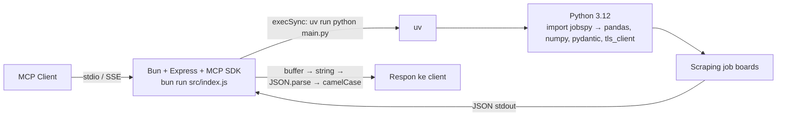

# Analisis Konsumsi Sumber Daya JobSpy MCP Server di Docker (VPS)

> **Status analisis:** statis — berbasis pembacaan kode, inspeksi dependensi yang terpasang di `jobspy/.venv`, dan interpretasi data `docker stats` yang diberikan. Container di VPS tidak dapat diakses langsung dari lingkungan ini, sehingga semua angka runtime di bawah adalah estimasi wajar + perintah verifikasi yang bisa dijalankan di VPS (lihat §8).

---

## 1. Ringkasan (TL;DR)

Container berjalan pada limit memori **256 MiB**, tetapi arsitektur proyek ini secara alami membutuhkan **±300–500 MiB saat pencarian aktif**. Akibatnya memori tertahan di **96.38%** dan container sangat rentan OOM (dibunuh kernel lalu di-restart diam-diam oleh `restart: unless-stopped`).

Penyebab utama:

1. **Dua runtime dalam satu container** — server MCP berbasis Bun/Node **plus** Python 3.12 yang mengimpor *data-science stack* berat (`pandas`, `numpy`, `pydantic`, `tls_client`) **secara cold-start setiap kali tool dipanggil**.
2. **`execSync` menahan & menggandakan seluruh hasil pencarian** di memori (buffer → string → parsed → camelCase = 3–4 salinan data).
3. **Desain SSE: satu instance `McpServer` penuh per koneksi klien**, semuanya ditahan sampai koneksi ditutup — memori berlipat seiring jumlah klien.
4. **Limit 256 MiB tidak cocok dengan kebutuhan** — bahkan nilai `memory: 1G` di `docker-compose.yml` tidak pernah berlaku (lihat §4.6).
5. **Block I/O tulis 609 MB** — indikasi aktivitas tulis yang tidak normal untuk server semacam ini (diduga uv cache + overlay2 copy-up, lihat §4.5).

CPU hanya **0.17%** → ini **murni masalah memori**, bukan masalah komputasi.

---

## 2. Membaca data `docker stats`

```
938e730b08a4  job-spy-mcp-1  0.17%  246.7MiB / 256MiB  96.38%  7.97MB / 9.67MB  609MB / 208MB  6
```

| Kolom | Nilai | Interpretasi |
|---|---|---|
| `CPU %` | 0.17% | Hampir idle; scraping bersifat network-bound, bukan CPU-bound |
| `MEM USAGE / LIMIT` | 246.7MiB / **256MiB** | Pemakaian nyaris menyentuh batas cgroup |
| `MEM %` | **96.38%** | Sangat kritis — lonjakan kecil saat pencarian bisa langsung OOM |
| `NET I/O` | 7.97MB / 9.67MB | Wajar (request/response scraping + SSE) |
| `BLOCK I/O` | **609MB tulis** / 208MB baca | Tidak wajar untuk server yang "hampir tanpa tulis" — dibahas di §4.5 |
| `PIDS` | 6 | Lebih dari 1 proses: Bun utama + proses healthcheck + sisa proses pencarian (uv → python) |

### Catatan penting tentang limit 256 MiB

Limit tersebut **bukan berasal dari `docker-compose.yml`**. File compose memakai:

```yaml
deploy:
  resources:
    limits:
      memory: 1G
```

Blok `deploy` **hanya dihormati oleh Docker Swarm**, dan **diabaikan oleh `docker compose up`**. Karena itu limit 256 MiB yang tampil di `docker stats` pasti berasal dari **platform/host VPS** (cgroup, panel manajemen container, atau konfigurasi runtime host) — bukan dari konfigurasi repo ini.

---

## 3. Arsitektur & alur kerja saat ini



1. `ENTRYPOINT ["bun", "run", "src/index.js"]` menjalankan server MCP (Express + `@modelcontextprotocol/sdk` + zod + winston).
2. Saat tool `search_jobs` dipanggil, `searchJobsHandler` di `src/tools/search-jobs.js` menjalankan:
   ```js
   result = execSync(cmd, { timeout, cwd }).toString();
   const parsedData = JSON.parse(result);
   const data = parsedData.map((job) => { /* changeCase.camelCase + normalisasi tanggal */ });
   ```
   dengan `cmd` = `uv run python main.py ...` (runner `uv`) atau `docker run --rm jobspy ...` (runner `docker`).
3. `jobspy/main.py` memanggil `from jobspy import scrape_jobs` — dan import inilah yang memuat seluruh stack berat setiap kali dijalankan.

---

## 4. Penyebab utama konsumsi memori

### 4.1 Dua runtime + cold-start Python per request

Inspeksi `jobspy/.venv` (hasil aktual, bukan dugaan) menunjukkan stack yang terpasang oleh `python-jobspy==1.1.82`:

| Paket | Versi | Catatan |
|---|---|---|
| `pandas` | 2.3.3 | Berat; kompilasi native (Cython) |
| `numpy` | 1.26.3 | Berat; native |
| `pydantic` + `pydantic_core` | 2.13.4 / 2.46.4 | Native (Rust) |
| `tls_client` | 1.0.1 | Native; dipakai JobSpy untuk bypass anti-bot |
| `regex` | 2024.11.6 | Native |
| `bs4`, `markdownify`, `requests`, `urllib3`, `charset_normalizer`, `lxml`-ekuivalen, dsb. | — | Pendukung scraping |

Estimasi RSS (Linux) saat proses pencarian berjalan:

| Komponen | Estimasi RSS |
|---|---|
| Server Bun idle (Express + MCP SDK + zod + winston) | 60–90 MiB |
| Proses `uv` (wrapper, transient) | 20–30 MiB |
| Python 3.12 baseline | ~12 MiB |
| `import numpy` | +35–50 MiB |
| `import pandas` | +70–120 MiB |
| `import jobspy` + pendukung | +30–60 MiB |
| **Total puncak saat pencarian** | **±300–400 MiB** |

> **Puncak ini melebihi limit 256 MiB.** Tidak ada proses Python yang di-warm-up; setiap request membayar penuh biaya import + alokasi, lalu semuanya dihancurkan lagi setelah proses selesai.

### 4.2 `execSync` menahan & menggandakan seluruh hasil

`src/tools/search-jobs.js`:

```js
result = execSync(cmd, { timeout, cwd }).toString(); // salinan 1: buffer stdout → string
const parsedData = JSON.parse(result);                // salinan 2: string → objek
const data = parsedData.map(...);                     // salinan 3: objek → objek camelCase
```

Dengan `resultsWanted` default 20 **per situs** dan hingga 7 situs (`indeed,linkedin,zip_recruiter,glassdoor,google,bayt,naukri`), plus deskripsi dalam Markdown, stdout JSON dapat mencapai puluhan MB — dan tersimpan **3–4× sekaligus** di memori pada waktu yang sama. `execSync` juga memblokir event loop Bun selama pencarian berlangsung (default timeout proses 60–120 detik).

### 4.3 SSE: satu `McpServer` penuh per koneksi

`src/index.js` memanggil `createMcpServer()` untuk **setiap** koneksi `GET /sse`:

```js
app.get('/sse', async (req, res) => {
  const transport = sseManager.createTransport('/messages', res);
  const server = createMcpServer();   // instance penuh: tools + prompts + schema
  ...
});
```

- SDK MCP hanya mendukung satu transport per instance server → desain ini "dipaksa", tetapi konsekuensinya: **N klien SSE = N × memori baseline server MCP**.
- Semua instance ditahan di `servers` (Set) dan `sseManager.transports` **sampai koneksi ditutup**. Tidak ada timeout/evict koneksi idle di `sseManager.js` → koneksi yang tidak ditutup bersih akan bocor.
- Setiap pencarian yang sedang aktif juga menjalankan `setInterval` progres tiap 2 detik per klien — churn memori/CPU kecil namun terus-menerus.

### 4.4 Healthcheck spawn proses Bun tiap 30 detik

`Dockerfile`:

```dockerfile
HEALTHCHECK --interval=30s ... CMD bun -e "fetch('http://localhost:9423/health')..."
```

Setiap 30 detik muncul 1 proses Bun baru (±20–40 MiB transient). Ini menjelaskan sebagian dari **6 PIDS** dan lonjakan memori/CPU periodik kecil saat idle.

### 4.5 Block I/O tulis 609 MB — tidak normal

Server semacam ini seharusnya hampir tanpa aktivitas tulis disk. Dugaan sumber (urut kemungkinan):

1. **overlay2 copy-up**: venv yang dibakar ke dalam layer image (±400–600 MB di disk) — setiap file venv yang disentuh/diubah saat runtime (perbaikan metadata oleh uv, bytecode, cache) disalin ke writable layer container, terhitung sebagai blok tulis.
2. **uv cache/fingerprint**: image hanya membawa `jobspy/main.py` — **tanpa `pyproject.toml`/`uv.lock`** — sehingga `uv run` tidak punya lock untuk diandalkan dan dapat melakukan resolusi/penulisan cache per pemanggilan.
3. **Log driver `json-file`**: output winston → stdout dicatat sebagai I/O container.

Verifikasi di VPS: `docker diff <container>`, `docker system df -v`, dan bandingkan `docker stats` saat idle vs saat pencarian.

### 4.6 Limit 256 MiB yang tidak cocok dengan kebutuhan

- `deploy.resources.limits.memory: 1G` di compose **diabaikan** oleh `docker compose up` (Swarm-only).
- Limit riil 256 MiB berasal dari host/platform.
- Pada cgroup v2, angka `docker stats` (`memory.current`) **juga menghitung page cache file** — sebagian dari 246.7 MiB saat "hampir idle" adalah cache file venv yang bisa direklamasi. Namun saat pencarian memicu alokasi RSS baru, kombinasi **RSS + cache** menembus 256 MiB → OOM kill.

---

## 5. Estimasi profil memori

| Kondisi | Komponen | Estimasi |
|---|---|---|
| Idle | server Bun | 60–90 MiB |
| Idle | page cache venv (reclaimable) | +50–150 MiB |
| Pencarian aktif (puncak) | Bun + uv + Python(pandas/jobspy) + buffer JSON | 300–400 MiB |
| Multi-klien SSE | +N × instance McpServer | +N × (5–15 MiB) |

**Kesimpulan:** kebutuhan riil ≥ **512 MiB**; nilai aman dan disarankan: **1 GiB**.

---

## 6. Mengapa CPU 0.17% tetapi memori 96%?

Beban kerja scraping bersifat *network-bound* (menunggu respons situs), sehingga CPU nyaris tidak terpakai. Masalahnya murni **footprint memori**: baseline proses + lonjakan Python saat pencarian ditampung dalam batas 256 MiB yang terlalu kecil. Ini bukan kebocoran komputasi — ini ketidakcocokan limit vs arsitektur.

---

## 7. Rekomendasi

### Prioritas tinggi

1. **Naikkan limit memori** (perbaikan langsung, hari ini):
   - Di `docker-compose.yml`, tambahkan kunci compose-native yang **benar-benar** dihormati `docker compose up`:
     ```yaml
     services:
       mcp:
         mem_limit: 1g
         mem_reservation: 512m
     ```
   - Dan/atau sesuaikan limit 256 MiB di panel/platform VPS tempat container berjalan.
2. **Pisahkan JobSpy dari server MCP** (perbaikan arsitektur):
   - Jadikan `jobspy` **sidecar service** tersendiri di compose, atau
   - Bungkus `main.py` menjadi **worker Python persisten** (mis. FastAPI/HTTP kecil) yang mengimpor `pandas`/`jobspy` **sekali** dan melayani banyak permintaan. Ini menghilangkan cold-start import dan mengisolasi lonjakan memori ke service terpisah.
3. **Ganti `execSync` → `spawn`/streaming** (atau langsung panggil worker persisten): hindari menahan seluruh stdout di memori dan hindari duplikasi `toString()` → `JSON.parse` → `map`.

### Prioritas sedang

4. **Panggil Python langsung tanpa `uv` per request**: di dalam image, `VIRTUAL_ENV=/app/jobspy/.venv` dan `PATH` sudah diset — cukup jalankan `/app/jobspy/.venv/bin/python main.py`. Alternatif: `uv run --no-sync --no-cache`. Ini menghemat 1 proses + mengurangi tulis cache (berdampak pada block I/O 609 MB).
5. **Kecilkan data default**: batasi `resultsWanted`, dan ubah default skema `linkedinFetchDescription` dari `true` → `false` (mengambil deskripsi LinkedIn jauh lebih lambat dan lebih besar). Tambahkan pagination/offset.
6. **SSE yang lebih hemat**: migrasi ke **Streamable HTTP transport** MCP SDK (satu instance server melayani banyak sesi HTTP), atau minimal tambahkan batas koneksi maksimum + evict koneksi idle di `SseManager`.

### Prioritas rendah

7. Healthcheck lebih ringan dan/atau interval 60 detik.
8. Audit writable layer (`docker diff`) — jika uv menulis besar, set `UV_NO_CACHE` atau sertakan `pyproject.toml` + `uv.lock` ke dalam image.
9. Tambah monitoring/alert saat `MEM% > 80%`.

---

## 8. Perintah verifikasi di VPS

```bash
# Sumber limit memori (bukan dari compose, karena deploy diabaikan)
docker inspect job-spy-mcp-1 --format '{{.HostConfig.Memory}}'

# Profil memori real-time (idle vs saat pencarian)
docker stats --no-stream

# Proses apa saja yang hidup di dalam container (mengapa 6 PIDS)
docker top job-spy-mcp-1
docker exec job-spy-mcp-1 ps aux --sort=-rss

# Pemakaian memori cgroup (v2: memory.current; v1: memory.usage_in_bytes)
docker exec job-spy-mcp-1 cat /sys/fs/cgroup/memory.current 2>/dev/null \
  || docker exec job-spy-mcp-1 cat /sys/fs/cgroup/memory/memory.usage_in_bytes

# Apa yang menulis 609 MB ke disk
docker diff job-spy-mcp-1 | head -50
docker system df -v

# Pastikan compose tidak menerapkan limit apa pun
docker compose config | grep -i -A5 memory
```

---

## 9. Kesimpulan

Container ini sehat dari sisi CPU, tetapi menjalankan **stack dua runtime (Bun + Python/pandas/numpy) yang cold-start per request** di dalam **limit 256 MiB** — kebutuhan puncaknya ±300–400 MiB. Diperparah oleh buffering `execSync` yang menggandakan hasil pencarian, desain SSE yang mengalokasikan satu `McpServer` per koneksi, dan aktivitas tulis disk dari uv/overlay2.

- **Solusi jangka pendek:** naikkan limit ke 1 GiB (`mem_limit: 1g` + penyesuaian di panel VPS).
- **Solusi jangka panjang:** pisahkan/daemonize sisi Python (worker persisten), ganti eksekusi sinkron dengan streaming/worker call, dan perbaiki transport SSE.
